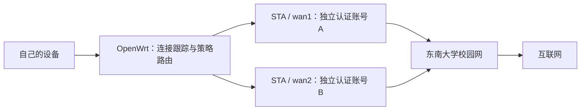

# 玩转东南大学校园网：从 AC10 WISP 到 AX3600 OpenWrt

## Abstract

这篇文章记录我在东南大学校园网中，从腾达 AC10 升级到小米 AX3600 的使用过程。最初的需求很简单：用一个东大校园网账号，让电脑、手机和平板接入自己的 Wi-Fi。AC10 原厂固件的 WISP 模式就能完成这一层需求。后来，我把 AX3600 刷成 OpenWrt，通过两个无线 STA 上行分别连接东大校园网，再用独立认证、策略路由和按连接负载均衡管理多个账号的出口。在此基础上，将原本运行在电脑上的 Clash 配置迁移到路由器，只让指定设备参与规则分流，并配置 DNS 去广告。

文章先解释 AP、STA、WISP、NAT 和多账号认证的关系，再介绍三个层次的玩法与选路由器的要求。

## 1. Introduction：先理解这套网络在做什么

### 1.1 三个阶段分别解决什么问题

| 阶段 | 我的设备／方案 | 主要目标 |
|---|---|---|
| 基础玩法 | 腾达AC10 原厂 WISP | 一个校园账号，多个本地设备共享上网 |
| 进阶玩法 | 小米AX3600 + OpenWrt + `seu-balancer` | 多个独立认证出口，按连接分担流量，失效时调整出口 |
| 再进阶玩法 | OpenClash／Mihomo + adblock | 指定设备规则分流、统一管理代理、减少广告域名请求 |

这三个阶段是逐层增加功能。普通上网没稳定之前，先不要把多出口、代理和 DNS 过滤一起打开，否则出问题时很难定位。

本文面向东南大学校园网用户，接入方式是路由器无线连接校园 AP，再通过 `w.seu.edu.cn` 完成上网认证。后面的共享、多账号和分流，都建立在这条接入路径上。AC10 的部分对应 WISP 方案，AX3600 的部分对应 OpenWrt 的实际配置。[东南大学校园网指南](https://nic.seu.edu.cn/fwzn/xywzh.htm)

### 1.2 AP 和 STA：一台路由器的两个角色

**AP（Access Point）是提供 Wi-Fi 接入的一方。** 手机、电脑连接自己的路由器时，这台路由器的无线接口就在承担 AP 角色。

**STA（Station）是连接 Wi-Fi 的客户端。** 路由器无线连接东大校园 AP 时，它的上行无线接口就是 STA；对于校园 AP 来说，这个接口与一台无线终端类似。

因此，同一台路由器可以一边用 STA 连接校园网，一边用 AP 向自己的设备提供 Wi-Fi。AP／STA 描述无线接口的角色，NAT、DHCP 和路由是另外几层功能，并不是“开启 STA”就自动具备。是否支持 AP 与 STA 并发、允许多少个接口，要看硬件和驱动支持。[Linux Wireless 模式说明](https://wireless.docs.kernel.org/en/latest/en/users/documentation/modes.html)


一个容易忽略的限制是**无线空口也需要共享**。同一射频同时承担 AP 和 STA 时，常见配置需要跟随上游信道，收发会竞争同一段无线时间。两个虚拟接口不是两张独立网卡，两个账号也不代表无线容量翻倍。实际选型要看无线并发组合和可用射频，不能只数天线。

### 1.3 WISP：把无线连接作为 WAN

WISP 可以理解为“无线 WAN + 本地路由”：上游通过 Wi-Fi 接入，下游由路由器提供自己的 LAN、DHCP 和上网出口。

它与透明中继的关键区别，是下游设备是否进入独立的本地网络。腾达 AC10 的官方说明中，WISP 模式下的终端 IP 由 AC10 分配；Client+AP 模式下由上游分配。所以看到“无线中继”选项时，还要确认具体是哪一种模式。[腾达 AC10 官方说明](https://www.tendacn.com/in/material/show/2003137)

### 1.4 单账号为什么能给多个设备共享

在这次东大校园网配置中，STA 先关联校园 AP，再通过 DHCP 获得上游地址，随后在 `w.seu.edu.cn` 完成 Portal 认证。配套脚本使用该上行的源地址发起登录，并把它作为 `wlan_user_ip` 提交，认证后再单独检查这条出口能否访问互联网。

本地终端访问互联网时，路由器通过 NAT 把它们的源地址转换为自己的上游地址，并用连接跟踪记录返回数据应交给哪台终端。终端共享的是**同一个已认证出口**，并不是每台终端分别登录了校园网账号。

举一个仅用于说明的地址例子：

```text
电脑 192.168.8.101 ─┐
手机 192.168.8.102 ─┼─ NAT → STA 上游地址 → 已认证校园网出口
平板 192.168.8.103 ─┘
```

这就是我用 AC10 共享一个东大校园账号的原理：本地设备共用同一条已认证上行。NAT 不会额外增加账号带宽，也不等于增加了多个独立认证出口。

### 1.5 多账号需要多条可区分的认证连接

在一个浏览器里换账号，不等于路由器获得了两个独立出口。如果认证状态绑定到同一条上行连接，后登录的账号可能替换前一个账号。

多账号方案需要先建立多条可区分的上行，再让各条连接分别完成认证。在本文的无线方案中，每个 STA 有自己的接口和上游地址，账号登录请求要明确走对应的接口／源地址，避免所有认证请求都被默认路由送到同一出口。



独立 MAC 只是其中一个条件。硬件必须支持接口组合，上游必须分配地址，账号必须允许相应接入，认证后还要验证互联网是否真的可达。

### 1.6 负载均衡分配的是连接

我采用的是按连接负载均衡：新连接选择一个上行，之后保持这个出口，避免同一连接的数据包在不同出口之间来回切换。

例如两条线路按 2:1 配置时，大量新连接会倾向于把约三分之二分给第一条、约三分之一分给第二条。这个比例描述的是连接选择，不保证流量字节数或实时带宽恰好是 2:1。

**一个普通 TCP 连接通常仍只经过一条线路。** 多设备或多连接并行时，总吞吐才可能增加；单连接下载并不会自动获得两个账号带宽之和。两个上行如果共用东大校园 AP、无线信道或总出口，也会遇到共同瓶颈。这与需要远端配合的链路绑定是不同方案。[OpenWrt 多 WAN 原理](https://openwrt.org/docs/guide-user/network/wan/multiwan/mwan3)

## 2. 基础玩法：AC10 的 WISP 单账号共享

### 2.1 这一阶段怎么选路由器

| 要求 | 为什么需要 |
|---|---|
| 原厂固件明确支持 WISP／无线 WAN | 需要独立 LAN 和路由，普通中继不一定具备相同行为 |
| 能作为 STA 连接东大校园 Wi-Fi | 频段、加密与认证方式必须兼容 |
| 提供本地 DHCP、NAT 和管理页面 | 让设备连接自己的网络，并通过已认证上行访问互联网 |
| 最好支持双频，信号与散热稳定 | 上行质量往往比标称无线速率更重要 |
| 千兆网口按实际用途选择 | 有线电脑或较高吞吐需求才更需要它 |

这一层不要求刷机，也不要求高性能 CPU 或大量闪存。购机前核对完整型号、硬件版本和固件功能；腾达部分型号有WISP模式，其他的品牌可以自行研究。大概30左右就可以解决。

### 2.2 我的使用流程

我最初使用 AC10 原厂固件，不改系统：

1. 进入路由器管理页面，选择 WISP 模式。
2. 扫描校园 Wi-Fi，选中上游，按实际网络填写无线参数。
3. 设置自己的 Wi-Fi 名称、密码与 LAN 网段，避免与上游网段冲突。
4. 手机或电脑连接 AC10 的 Wi-Fi，打开 [东大校园网认证入口](https://w.seu.edu.cn/)，完成一次校园账号认证。
5. 关闭终端自己的移动数据或其他代理进行验证，确认电脑、手机和平板都通过 AC10 上网。

这里的“登录一次”不意味着永远在线。上游断开、租约或认证状态变化后，可能需要重新认证；原厂固件如果没有认证保活能力，就要手动处理。

### 2.3 能解决什么，什么时候需要升级

AC10 解决了“自己的设备接到同一个 Wi-Fi，共享一个校园账号”的问题，配置少，也容易恢复。

这一层仍受单账号、单上行和无线中继性能限制。多账号独立认证、出口健康检测、按设备代理与统一 DNS 过滤，需要更开放的系统。

## 3. 进阶玩法：AX3600 刷 OpenWrt，多账号负载均衡

### 3.1 这一阶段怎么选路由器

首先确认 **OpenWrt 支持准确的型号与硬件版本**，并且有对应的镜像、安装说明和恢复办法。其次，再看无线并发能力与资源余量。

| 要求 | 选择时重点看什么 |
|---|---|
| 明确的 OpenWrt 设备支持 | 能否稳定运行、如何恢复原厂、镜像适用什么分区 |
| 满足多上行与本地 AP 的无线组合 | 射频数量、驱动允许的 STA 数量、同信道限制与上游兼容性 |
| 策略路由和 nftables 支持 | 让不同连接选择不同路由表，而非只有几个不同的默认路由 metric |
| 足够的内存和可写空间 | 认证脚本、无线服务、连接跟踪都需要资源 |
| 千兆网口和稳定供电 | 便于接有线终端、刷机恢复与长期运行 |

作为本文这种玩法的选型建议，可以优先考虑 256 MB 以上内存、128 MB 以上闪存，并留意**实际可写分区**。这些是经验建议，不是 OpenWrt 的统一最低配置；多上行是否可用，通常比容量数字更关键。

我选用的 AX3600 配置如下：

| 项目 | 配置 |
|---|---|
| 处理器 | 高通 IPQ8071A，四核 Cortex-A53，约 1.4 GHz |
| 硬件网络加速单元 | 双核 1.7 GHz NPU；能否使用取决于固件 |
| 内存／闪存 | 512 MB 内存、256 MB NAND 闪存 |
| 主要无线规格 | 2.4 GHz 2×2、5 GHz 4×4，支持 Wi-Fi 6 |
| 网口 | 一个千兆 WAN、三个千兆 LAN |
| 本文运行环境 | OpenWrt 25.12.5、Linux 6.12.94、firewall4／nftables |


### 3.2 刷机必要的准备

本文不展开刷机操作，按 [OpenWrt AX3600 设备页](https://openwrt.org/toh/xiaomi/ax3600)和对应版本的安装说明执行。必须确认设备版本、原厂／修改分区与镜像匹配，并提前备份配置、准备恢复方式。不能把适用于另一种分区布局的命令直接复制过来。

刷好以后，先恢复 LAN、管理入口、一个 STA 上行和校园网认证，确认普通上网正常，再增加第二条上行。整个过程需要重刷系统并会暂时断网。

AX3600 芯片有 NPU，但当前这套官方 OpenWrt 没有完整 NSS 加速支持。社区另有 NSS 固件，通常涉及另一套内核与驱动；本文没有刷 NSS。[OpenWrt 加速说明](https://openwrt.org/docs/guide-user/perf_and_log/flow_offloading)、[社区 NSS 项目](https://github.com/qosmio/openwrt-ipq)

### 3.3 用了哪些上行

核心是两个 STA 上行：

| 上行 | 无线配置 | 功能 |
|---|---|---|
| `wan1` | `radio1` 上的 STA | DHCP 地址、独立认证、独立路由表 |
| `wan2` | `radio0` 上的 STA | DHCP 地址、独立认证、独立路由表 |


经过实践，路由器的性能差不多就只能支撑同时当两个STA，第三路基本残废，无法跑满性能。

### 3.4 独立认证要怎样做

每条上行先完成无线关联和 DHCP，然后使用对应源地址发起校园网登录。流程是：

```text
STA 关联上游
    ↓
取得该接口的 IP、网关与设备名
    ↓
登录请求绑定到该上行源地址
    ↓
通过东大 Portal 完成对应账号登录
    ↓
通过这条上行检查互联网可达性
    ↓
将健康出口加入负载均衡候选列表
```

绑定登录请求只是第一步；策略路由也要保证这个源地址的请求从原来的上行出去。如果所有认证请求都走默认路由，就可能出现“填了两个账号，实际只认证了一个出口”。

东大 Portal 的请求参数和结果处理在 [SEU 认证与负载均衡脚本](scripts/seu-balancer.py)的 `authenticate()` 中，单次调试可以使用 [登录入口](scripts/seu-login.py)。账号密码保存在路由器本地的 `accounts.json`，仓库只提供占位示例。

### 3.5 `seu-balancer` 的实际工作方式

这次路由器运行的是自定义 Python 服务 **`seu-balancer`**。仓库提供[脱敏整理后的发布版脚本](docs/scripts.md)，包括单独登录入口、配置示例和清理方法。脚本针对东大 Portal，不创建无线接口，部署前要按本机调整上行与 LAN 参数。

实机脚本和 nftables 规则显示：

- **接口发现**：通过 `ubus` 获取 `wan1`、`wan2` 的地址、网关和实际设备名。
- **独立路由表**：给每条上行建立路由表，并配置源地址规则和 `fwmark` 规则。
- **连接选择**：新连接没有线路标记时，由 nftables 的 `numgen inc` 按权重选择线路。
- **连接保持**：把选择结果写入 `ct mark`，后续数据包恢复标记，继续查同一路由表。
- **健康检测**：从对应上行源地址发起 HTTPS 探测，避免仅凭“接口 UP”判断已经能上网。
- **状态调整**：正常情况下约每 30 秒检查一次；连续两次成功加入候选、三次失败移除，必要时尝试重新认证。

当前权重是 **`wan1:wan2 = 2:1`**。简化后的选择逻辑如下，省略了防火墙、回程与异常处理：

```text
新连接 1 → wan1 → 保存连接标记
新连接 2 → wan1 → 保存连接标记
新连接 3 → wan2 → 保存连接标记
下一组继续循环；已有连接保持原出口
```

独立路由表解决“从哪里出去”，防火墙的 WAN 转发与 masquerade 解决“LAN 地址怎样转换为出口地址”。两者都要核对，只有负载均衡选择规则并不能让连接正常返回。

路由器自身发出的 DNS、时间同步等流量另行选择健康上行，不能假设它们会经过 LAN 入站的分配规则。故障转移也不保证已有连接无中断：新连接可以改走健康线路，失效线路上的老连接可能需要重新建立。

如果选择现成多 WAN 管理插件，也要核对 OpenWrt 与防火墙版本。旧 iptables 版 mwan3 的安装命令不应直接套在本文的 nftables 环境上；社区另有 [mwan3-nft 方案](https://openwrt.org/docs/guide-user/network/wan/multiwan/mwan3-nft)，需要单独评估，本文未部署它。


## 4. 再进阶玩法：路由器上的 Clash 和去广告

### 4.1 这一阶段怎么选路由器

代理会增加规则匹配、DNS 和加解密开销，DNS 广告列表也会占用内存。选择重点从“能连上多个上行”进一步转向“这些服务同时运行是否还有余量”。

| 要求 | 建议 |
|---|---|
| CPU 架构与代理内核兼容 | 选有对应 Mihomo 构建的架构，核对依赖和内核模块 |
| 内存余量 | 本文这种组合建议以 512 MB 为起点；大规则集或更多服务优先考虑 1 GB 以上 |
| 足够的可写存储 | 看 overlay 实际剩余空间，内核、规则数据库和更新文件都需要空间 |
| nftables／TPROXY／TUN 支持 | 依运行模式核对依赖，不能只装 LuCI 页面 |
| 可维护性 | 能备份、查日志、更新并撤回规则，长期稳定比插件数量重要 |

这些容量是选型建议，不是软件统一最低配置。AX3600 能运行本文的组合，但规则加载时出现过内存不足提示，需要控制规则规模。

路由器中，小米部分路由器官方对OpenWRT的支持较好，可以考虑部分型号。

本人的AX3600以大约100左右买到。
### 4.2  Clash 迁移到路由器

我原本在电脑上使用 Clash Verge。迁移到路由器后，OpenClash 提供 LuCI 管理界面，Mihomo 内核负责代理和规则处理。本文环境安装了 OpenClash 0.48.002 与 Mihomo 1.19.32，版本仅记录本次环境。[OpenClash 项目](https://github.com/vernesong/OpenClash)、[Mihomo 文档](https://wiki.metacubex.one/)

部署顺序是：

1. 先确认不使用代理时，校园网出口正常。
2. 安装插件、对应架构的内核和运行模式所需依赖。
3. 导入可信的订阅或 YAML 配置，检查节点和规则能否加载。
4. 设置设备白名单，先只加入一台设备测试。
5. 使用 **Rule** 模式，分别测试直连、代理和 DNS。
6. 确认有效后，再加入其他自己的设备。

订阅链接往往包含访问凭据，不能当成普通公开链接上传。成功导入 YAML 也只说明有配置，不能代替实际节点连接测试。

### 4.3 设备白名单和 Rule 模式是两层控制

**设备白名单决定谁的流量进入代理处理；Rule 决定进入后走哪条规则。** 所以白名单设备并不等于所有流量都走境外节点：本地与校园资源可以直连，其他访问按配置匹配。[Mihomo 规则说明](https://wiki.metacubex.one/config/rules/)

本文用 MAC 白名单管理自己的电脑、手机和平板：

1. 进入 **Plugin Settings → Black&White**。
2. 将 **LAN Access Control Mode** 设为 **White List Mode**。
3. 在 **LAN Proxied Mac List** 添加当前 Wi-Fi 连接实际使用的 MAC。
4. 保存后点击 **Apply Settings**，并核对运行中的白名单。

在这次版本中，白名单选项有显示条件。使用 Fake-IP 时，需把 **DNS Settings → Redirect Local DNS Setting** 设为 **Firewall Redirect**；或者按实际需求选择受支持的 Redir-Host 模式。本文后续检查到的运行模式为 Redir-Host，DNS 劫持为防火墙转发。[OpenClash 设置源码](https://github.com/vernesong/OpenClash/blob/master/luci-app-openclash/luasrc/model/cbi/openclash/settings.lua)

设备最好关掉随机mac，不然路由器名单上只记录固定的mac，再次登录的时候设备可能会mac，使用设备本身的mac就不会出现问题。


### 4.4 去广告：从 DNS 域名过滤开始

本文路由器配置的是 **OpenWrt adblock + dnsmasq**。adblock 获取和整理广告域名列表，dnsmasq 在解析时按列表拦截。它的目标是让已知广告域名无法正常解析，并不需要给每台终端安装同一个客户端。具体软件选择与配置可参考 [OpenWrt 去广告指南](https://openwrt.org/docs/guide-user/services/ad-blocking)。

概念上的处理路径如下：

```text
终端 DNS 查询
    ↓
路由器的广告域名过滤
    ├─ 命中：返回阻止结果
    └─ 未命中：交给合适的上游 DNS 解析
```

选择小而适合自己的规则集开始，给东大认证、验证码、应用登录等误拦截域名添加例外，检查 DNS 日志与返回结果，再逐步增加列表。adblock 的界面显示“已启用”，不代表每台设备的 DNS 都经过了过滤。

DNS 过滤有明确边界：广告与正文使用同一域名时，无法只靠域名区分；客户端自行使用 DoH／DoT、缓存或其他解析路径时，可能不经过路由器过滤。网页元素隐藏通常仍需要浏览器端工具。[DNS 过滤原理](https://github.com/AdguardTeam/KnowledgeBaseDNS/blob/master/docs/general/dns-filtering.md)

### 4.5 Clash 与去广告必须检查 DNS 路径

这是组合玩法里最容易漏掉的一步。白名单设备的 DNS 如果被 OpenClash 从 53 端口直接转到 Mihomo，可能绕过 dnsmasq 的广告过滤；如果两个 DNS 服务互相转发，又可能形成循环。

因此不能只看到“OpenClash Running”和“adblock Enabled”，就认定两者叠加成功。应明确普通设备和代理设备各自的解析链路：可以让代理 DNS 的合适上游经过独立端口的过滤解析器，也可以在代理规则中使用相应拒绝规则，但必须核对上游、监听端口和是否存在循环。

不要把下列关系直接照抄成配置：

```text
dnsmasq → Mihomo → dnsmasq → ……  （循环）
```

### 4.6 代理负载均衡与校园多出口不是同一件事

`seu-balancer` 的入口规则作用于 LAN 进入路由器的流量，而 Mihomo 接收流量后会建立自己的出站连接。它们不一定保留相同的连接标记。

当前脚本为路由器本机流量选择一条健康上行，因此不能直接推导“Clash 也按两个校园账号的 2:1 权重出站”。如果要实现这一点，需要额外设计代理出站的接口绑定、标记或策略，并验证回程与故障行为。

同样，Clash 配置里的代理组 `load-balance` 是在代理节点之间选择，与校园上行之间的负载均衡属于不同层次。调试时先保证每层独立可用，再验证两层组合后的真实路径。

## 5. 脚本与配置示例

| 文件 | 用途 |
|---|---|
| [登录入口](scripts/seu-login.py) | 检查指定上行的有效路由，单次认证并验证互联网可达性 |
| [认证与负载均衡服务](scripts/seu-balancer.py) | 两条上行自动认证、健康检测、按连接 2:1 分配 |
| [账号配置示例](config/accounts.example.json) | 只包含占位符；真实文件在路由器本地填写 |
| [OpenWrt 服务文件](scripts/seu-balancer.init) | procd 启停示例，LAN 参数需要按现场修改 |
| [清理入口](scripts/cleanup-seu-balancer.sh) | 停用服务、清理预留策略并恢复已记录的参数 |
| [部署与回滚说明](docs/scripts.md) | 依赖、预留路由资源、安装流程、验证和发布版差异 |

仓库中的发布版保留现场实现的主要逻辑，补上单账号配置支持、路由失败检查和回滚，并默认关闭现场的射频自动重启。部署前阅读说明，尤其核对 LAN 网段、路由表、规则优先级和连接标记是否与其他服务冲突；离线测试通过不等于已经在其他设备和配置上验证。

按需求选择做到哪一步即可：只想共享一个账号，WISP 就能开始；需要多账号与故障处理，再考虑 OpenWrt；需要统一代理和 DNS 管理，最后增加这些服务。选路由器时，先看目标功能是否有可靠支持，再看无线能力、CPU、内存和实际可写空间。

## 6. Acknowledgement
部分思路参考SiliCOM电脑协会的老同志，感谢jg在本项目中提供的一些帮助。

